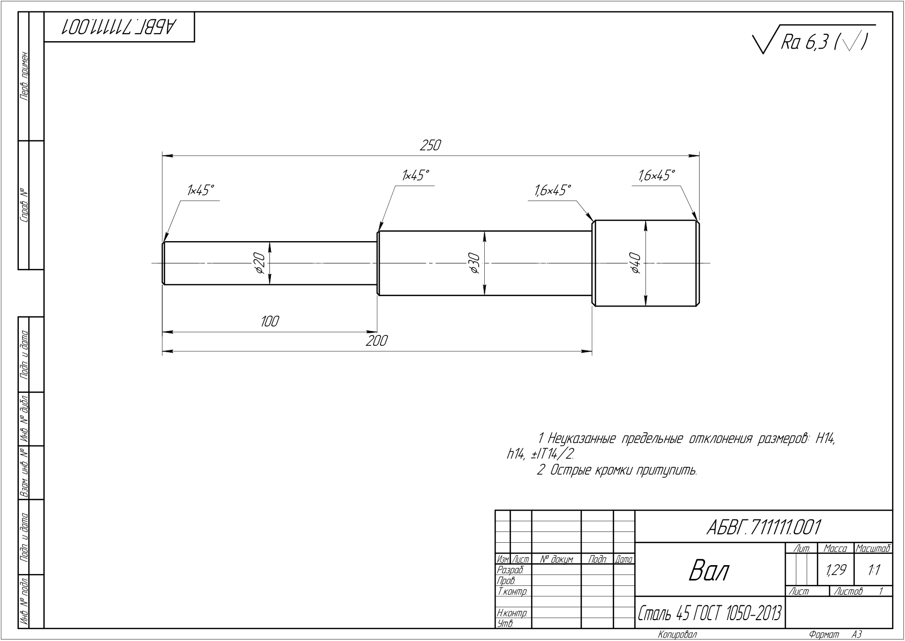
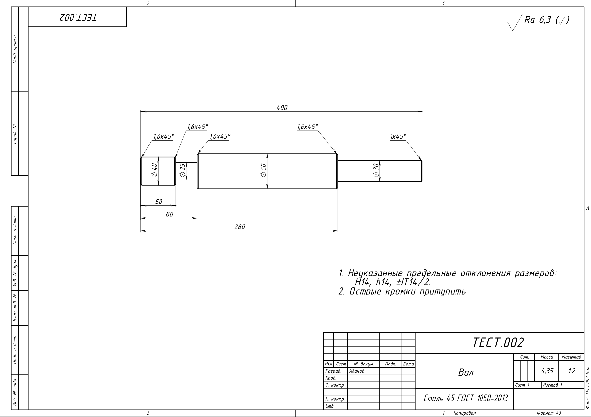
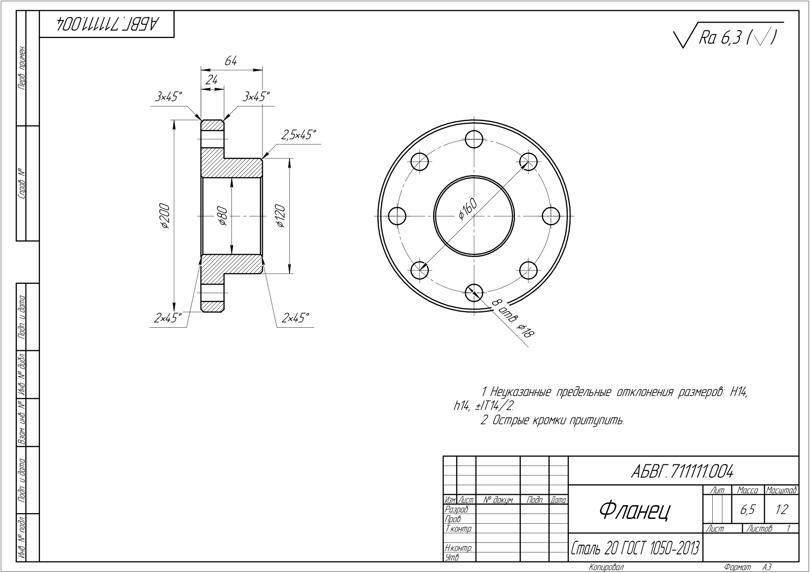
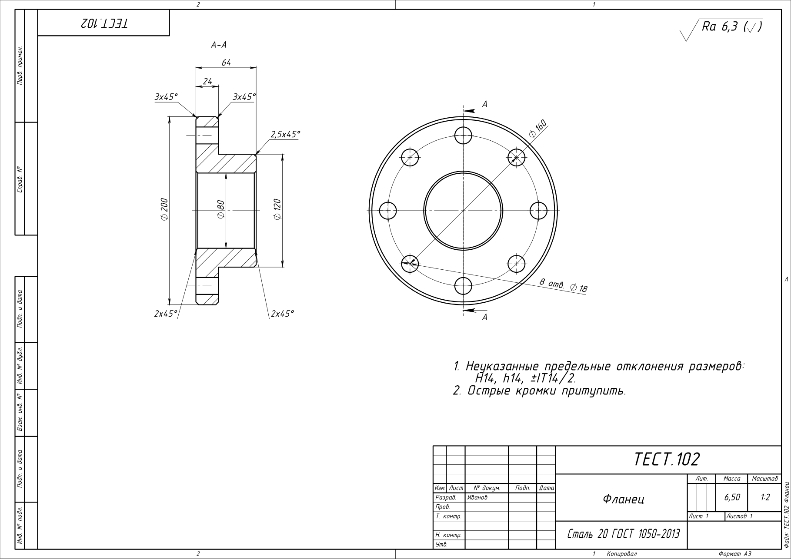

# Генератор деталей ЕСКД

Программа по введённым размерам сама строит **3D-модель, чертёж по ЕСКД (А3) и PDF** типовой детали
в **КОМПАС-3D** или **SolidWorks**. Можно строить по одной детали в окне или сразу пачкой из Excel.

> *English:* a Python tool that generates 3D models and GOST/ESKD-compliant drawings (A3 + PDF)
> of typical machine parts (stepped shafts, flanges) in KOMPAS-3D and SolidWorks via their COM APIs.
> GUI on tkinter, batch mode from Excel.

| КОМПАС-3D | SolidWorks |
|---|---|
|  |  |
|  |  |

PDF этих чертежей лежат в папке [`examples`](examples).

## Что умеет
- **Типы деталей:** вал ступенчатый, фланец (с отверстиями под крепёж и ступицей).
- **Модель** вращением эскиза, фаски заложены прямо в профиль (ГОСТ 10948 или своё значение).
- **Чертёж по ЕСКД:**
  - лист А3, основная надпись по ГОСТ 2.104, шрифт тип Б (ГОСТ 2.304);
  - линии 0,5 / 0,25 мм (ГОСТ 2.303);
  - масштаб подбирается сам по ГОСТ 2.302 (1:1, 1:2, 1:2,5, 1:4…);
  - диаметры, длины от торца и габарит, выноски фасок на полке (ГОСТ 2.307);
  - фланец: разрез через отверстия + вид слева с ØD1 и «n отв. Ød0» (ГОСТ 2.305);
  - шероховатость (ГОСТ 2.309), технические требования.
- **Масса** по плотности марки стали (Сталь 20/45/40Х — 7,85; 12Х18Н10Т — 7,9 г/см³) —
  совпадает в обеих САПР и с ручным расчётом.
- **Проверка размеров:** например, что отверстия фланца не выходят к краю и не налезают на ступицу.
- **Пакет из Excel:** шаблон → заполнили строки → программа строит всё подряд, делает отчёт
  со статусами и общий PDF-комплект для заказчика.

## Что нужно
- Windows, **Python 3.10+** (проверено на 3.14);
- **КОМПАС-3D v24** и/или **SolidWorks 2026** (пути к ним заданы в `kslib.py` и `sw_driver.py`).

## Установка
```bash
git clone <адрес этого репозитория>
cd cadgen
pip install --target lib -r requirements.txt
```
Библиотеки (pywin32, pymupdf, openpyxl) ставятся в папку `lib` рядом с программой, системный Python
не трогается. Можно и обычным `pip install -r requirements.txt`.

## Как запустить
Двойной щелчок по **`Запуск.bat`** (или `python -s app.py`).

1. Выберите САПР: **SolidWorks** или **КОМПАС-3D**. Результаты кладутся в `out\SolidWorks` или `out\КОМПАС-3D`.
2. Тип детали: «Вал ступенчатый» или «Фланец».
3. Вал — ступени слева направо, по одной в строке: `диаметр x длина` (например `30 x 100`).
   Фланец — D, d, толщина H, окружность отверстий D1, число n и диаметр d0 отверстий, ступица (0 — без неё).
4. Заполните основную надпись: наименование, обозначение, разработчик, материал.
5. Нажмите **«Построить модель и чертёж»**. Через 5–30 секунд файлы будут в папке `out`.

## Пакет деталей из Excel
1. Блок 6 в окне: **«Создать шаблон…»** — откроется Excel с листами «Валы» и «Фланцы» и примерами
   (или возьмите готовый `Шаблон пакета.xlsx`).
2. Заполните строки (одна строка = одна деталь), сохраните.
3. **«Построить из Excel…»** → выберите файл.
4. В папке `out` появятся:
   - `<файл> — отчёт <САПР> <дата>.xlsx` — ваша таблица + «Статус», «Масса», «Файл PDF»
     (зелёные строки — готово, красные — что не так);
   - `<файл> — комплект <САПР> <дата>.pdf` — все чертежи одним файлом.

Без окна: `python -s batch.py ks "Список деталей.xlsx"` (или `sw`).
Скорость: КОМПАС ≈ 4–5 с на деталь, SolidWorks ≈ 20 с.

## Устройство
Для каждого типа детали есть «мозг» (геометрия и правила, не зависит от САПР) и для каждой САПР —
«водитель» (команды её API через COM).

| Файл | Роль |
|---|---|
| `shaft.py` | «Мозг» вала + общее: материалы, фаски ГОСТ, масштабы, срез углов профиля |
| `flange.py` | «Мозг» фланца: геометрия, отверстия, проверки размеров |
| `sw_driver.py` | «Водитель» SolidWorks |
| `swlib.py` | Подключение к SolidWorks (`sldworks.tlb`) |
| `ks_driver.py` | «Водитель» КОМПАС-3D: API5 (3D) + API7 (чертёж, штамп, ТТ) |
| `kslib.py` | Подключение к КОМПАСу (`kAPI5.tlb`, `kAPI7.tlb`, константы) |
| `app.py` | Окно программы (tkinter) |
| `batch.py` | Пакет из Excel: шаблон, проверки, отчёт, общий PDF |
| `deps.py` | Подключает библиотеки из папки `lib` |
| `test_build.py` | Проверка без окна: `python -s test_build.py sw 1 2 f1 f2` (или `ks`) |

## Планы
- шероховатость на каждой поверхности вала;
- фаски на отверстиях под болты во фланце;
- втулка и другие типовые детали;
- допуски и посадки.
